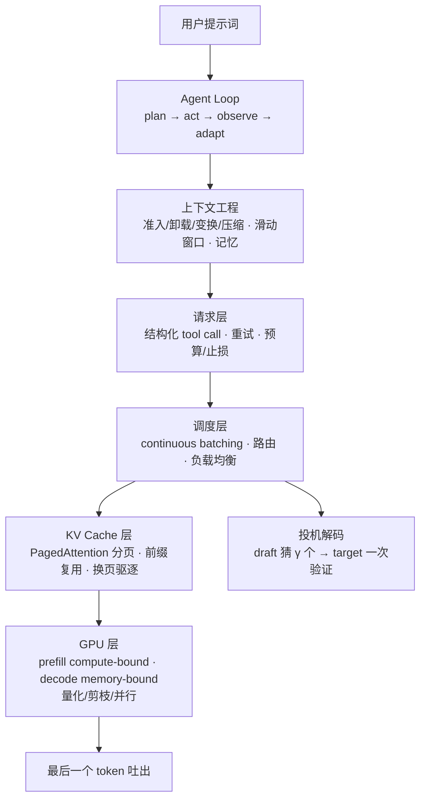

# 哈佛 CS2680《Modern AI Systems: Agents and System Optimizations》学习材料

> 从你敲下第一句提示词，到物理显卡吐出最后一个 token —— 一份把整条技术栈拆穿的中文学习笔记。
>
> 课程官网：<https://cs2680.seas.harvard.edu/>（备用域名 <https://cs2680.com>）
> 开课：Harvard SEAS，2026 秋季，Juncheng Yang 主讲（MaDSys 研究组支持），周一/周三 11:15–12:30，SEC LL2.229。

---

## 一、这门课到底在教什么

一句话：**跟着一个名为 Mads（Modern Agent Design and Systems）的智能体系统，从应用层 Agent Loop 一路往下拆，直到接管开源模型的推理服务与底层 GPU 硬件。**

课程不做分散的散点练习。全学期 14 周切成两大阶段：

| 阶段 | 周次 | 主题 |
|---|---|---|
| **Part I — 智能体设计与评估** | 第 1–7 周 | Claude Code 运行原理、多 Agent 协作、上下文与工具设计（ReAct）、记忆与可靠性、评测体系、成本性能权衡 |
| **Part II — LLM 与 Agent 的系统** | 第 8–14 周 | Transformer/LLM 基础、GPU 与 CUDA、批处理/分页/并行、vLLM 式 PagedAttention、投机解码、KV Cache 优化、Agent 请求调度、路由与负载均衡 |

### 为什么 Agent 是一个"系统问题"

第 1 讲的核心类比：**Agent = 一台新的计算机**

- LLM ≈ CPU（每次"指令"= 一次模型调用）
- 上下文窗口 ≈ RAM（有限、会满、需要换页）
- 工具 ≈ 外设（I/O，慢，可并行）
- Harness ≈ 操作系统（调度一切，决定生死）

由此推出课程反复强调的两个事实：

1. **LLM 系统是异构的**：prefill 是 compute-bound，decode 是 memory-bound；浮点非确定性让"复现"变成工程课题；状态巨大（权重 + KV Cache）；多 GPU 还要算通信。
2. **真正的优化目标是"每个成功任务的成本"（$ / solved task），不是 tokens/s。** 评测是 capability × cost × speed 的 Pareto 天际线。

Agent 的行为循环：**plan → act → observe → adapt**（规划、行动、观察、适应），即经典 ReAct 循环。

---

## 二、14 周路线（官方 Schedule）

| 周 | 主题 | 关键阅读 |
|---|---|---|
| 1 | 课程总览 | — |
| 2 | **Claude Code 是怎么工作的**（Agent 应用 I） | 官方最佳实践、Agentic Engineering Patterns |
| 3 | **多 Agent 与 100x 工程师**（Agent 应用 II） | Anthropic 多 Agent 研究系统、"don't build multi-agents"（反方观点） |
| 3 | **上下文管理与工具设计**（Agent 设计 I） | ReAct、LLM Powered Autonomous Agents（Lilian Weng） |
| 4 | **多 Agent 架构、协作与通信**（Agent 设计 II） | 多 Agent 扩展论文、A2A 协议 vs MCP |
| 5 | **Agent 记忆与可靠性**（Agent 设计 III） | MemGPT、"where agents fail" |
| 5 | **Agent 评测**（Agent 设计 IV） | 官方 Agent evaluation notes |
| 6 | 企业 Agent 开发（客座：Snowflake） | — |
| 6 | **成本与性能**（Agent 设计 V） | 官方 Cost-effective agents notes |
| 7 | Agent 安全、自进化 harness | OWASP Agentic Top 10 |
| 8 | **LLM 基础**（Transformer、Llama 3、MoE） | Transformer / Llama 3 / Mixtral 论文 |
| 8 | **GPU 入门**（CUDA 编程模型） | CUDA Programming Guide |
| 10 | 作业反馈 + GPU 编程（续） | — |
| 10 | **批处理、分页与并行** | Orca（continuous batching）、vLLM（PagedAttention） |
| 11 | 客座：基础设施如何决定 AI 的节奏（Meta） | — |
| 11 | **投机解码** | speculative decoding、EAGLE、Medusa、DSpark |
| 12 | **KV Cache 优化与模型架构**（学生主讲） | — |
| 13 | **剪枝与量化** | — |
| 14 | **高效 Agent 系统：调度与前缀缓存 / 路由与负载均衡** | — |

所有幻灯片 PDF 在本仓库根目录（`1_intro.pdf` … `11_llm_serving_basics_3.pdf`，讲师授权），每周要点摘要见 [README.md](README.md)。

---

## 三、五个贯穿式作业（从前端改到 GPU）

| # | 作业 | 权重 | 干什么 |
|---|---|---|---|
| 1 | **Mads-Lens** | 10% | 给 Claude Code 写 Web UI：实时可视化运行轨迹——工具调用入参/返回、子 Agent 树、报错定位、每次调用的 token 与花费 |
| 2 | **Mads-Loop** | 10% | 去掉现成客户端，**手写 Agent Runtime**：结构化工具调用、上下文滑动窗口、报错重试、退出判定。隐藏测试集专测容错 |
| 3 | **Mads-Opt** | 20% | 端到端优化：砍 token、简单任务分流小模型、工具并发、重构上下文；成功率不降的前提下压成本与延迟；交技术复盘博客 |
| 4 | **Mads-Serve** | 20% | 拿掉商业 API，在自己的 GPU 上部署开源模型，改**批处理调度**与 **KV Cache 复用**，按"完成任务数 + 总耗时"全班打榜 |
| 5 | **Mads-Stack** | 20% | 全栈放开（Agent 架构 + 模型选型 + 推理内核），统一用 Terminal-Bench 2.0 评测打榜 |

评分：作业 + 项目 + 课堂参与，无考试。作业 3 的榜单是 **Pareto 天际线**（解出任务数 × 单任务成本 × 单任务耗时）。

> 官方原话很直白：课上不会讲完作业所需的所有技术细节；想拿 A，做好课后大量自学与调试的准备。
> 先修要求：**CS61 + 至少一门研究生级系统课**，默认熟练 Python 与 PyTorch。这不是零基础入门课。

---

## 四、Part I 核心概念速记（第 1–7 周）

### 1. Agent Loop（第 2–3 讲）

```
while not done:
    context  = 收集上下文（文件、历史、工具结果）
    action   = 模型基于 context 提出动作（工具调用 / 回答）
    result   = harness 执行动作，拿到观察
    context += result          # 观察折回上下文
    if 模型输出结束标记: done
```

要点：

- 第一次按键之前，上下文里已经有 **>10K token**（系统提示、仓库结构、记忆文件）。仓库不是整包塞进去，而是靠 grep/read **按需**拉取。
- 上下文会持续增长 → 需要**压缩（compaction）**；权限模式决定工具能不能真执行。
- 记忆分层：`CLAUDE.md` 层级 → `.claude/rules/`（带 `paths:` 前置元数据）→ 自动记忆（MEMORY.md 索引）→ 扩展体系（Skill = 怎么做某件事，MCP = 外部访问，Hook = 生命周期强制行为，Plugin = 打包一切）。
- 多 Agent 扩展：并行 Agent（git worktree 隔离）、子 Agent、Agent 团队。案例：16 个 Agent 通过 Git 协作造了一个 C 编译器（花费约 $20K）。

### 2. 上下文工程（第 4 讲）

**上下文是有限资源**。四种控制手段：**准入（admission）、卸载（offloading）、变换（transformation）、压缩（compaction）**。
五种失败模式：**投毒、干扰、混淆、冲突、漂移**。

工具设计：搜索（grep/glob vs 语义索引 vs LSP）、编辑（整文件重写 vs unified diff vs 搜索替换 vs AST）、Shell 的风险与最佳实践。
提示工程谱系：zero-shot → few-shot → role → CoT → ToT → self-consistency → prompt chaining → meta prompting。

金句：**Agent = Model × Harness**。只改 harness 就能让 SWE-bench 准确率大约翻倍。

### 3. 多 Agent 系统（第 5 讲）

每个设计背后有三张图：**控制图、任务图、通信图**。八种架构：supervisor-worker、层级、流水线/DAG、黑板、委员会、市场、群体、动态拓扑——真实系统都是混合体。

任务分解的坑：重叠、缺口、隐藏依赖、掉队者（straggler）。通信 = 介质 + 通道 + 消息格式（结构化控制字段 + 自然语言内容）。多 Agent 继承所有分布式系统问题：幂等、部分失败。
设计原则（也是反方文章的观点）：**单个 Agent 往往就够了**；A2A 协议（agent cards、任务生命周期）对比 MCP。

### 4. 记忆与可靠性（第 6 讲）

记忆流水线：**写/跳过 → 编码 → 存储 → 检索 → 反思 → 遗忘**。格式（原始 episode、摘要、结构化状态、知识图谱）× 后端（文件、KV、向量、图库）；注意有效时间与来源（provenance）。基准：LoCoMo、LongMemEval、BEAM。

可靠性算术（最扎心的一行）：

> 单步成功率 95%，50 步任务无错跑完的概率 ≈ 0.95^50 ≈ **8%**。

故障来源五分类：任务规格 / harness / 模型 / 工具 / 环境，每类各有"故障-修复"对照表。设计原则：**为失败而设计**（重试、预算、止损规则）。

### 5. 评测（第 7 讲）

组件级 vs 端到端评测；pass@k 与 pass^k 的区别；成本与延迟进指标。基准巡礼：GAIA、BFCL、WebArena、OSWorld、SWE-bench、τ-bench、Terminal-Bench、TheAgentCompany。
挑战：全栈数据泄漏、单轮偏差、非确定性、副作用不惩罚、基准快速饱和。

### 6. 成本与性能（第 8 讲）

成本公式：

```
Cost = 用户数 × 会话数 × 轮数 × 步数 × token 数 × 单价
```

课程真实使用数据：约 **97.6% 的 token 是缓存读**，主 Agent 单步中位数 200K–300K token。
六个杠杆：**更少轮数、批量步骤、更瘦上下文、更短输出（effort 档位）、更低单价（缓存/批处理/路由）**，外加预算与止损规则、"能不能干脆不用 LLM"。
速度：关键路径、编排、并行、投机动作（PASTE、SPORK）。
Harness 架构：单体 / 模块化 / 微内核；横向比较了 8 个主流 harness。

---

## 五、Part II 核心概念速记（第 8–14 周）

### 1. LLM 与 GPU 基础（第 8–10 讲）

- Transformer / Llama 3 / MoE（Mixtral）：为什么 decode 阶段每生成 1 个 token 都要把全部 KV 从 HBM 读一遍 → **memory-bound**；prefill 一次算完 → **compute-bound**。
- GPU：SM、HBM 带宽、tensor core、warp/block/grid；CUDA 编程模型是后面所有优化的地基。
- 一次推理 = prefill（并行算全部 prompt token）+ decode（逐 token，受显存带宽限制）。

### 2. 批处理、分页与并行（第 10 讲）

- **Continuous batching（Orca）**：不等一批全部完成，请求完成即替换，吞吐数倍于 static batching。
- **PagedAttention（vLLM）**：KV Cache 像操作系统虚拟内存一样**分页**（block 化），按需分配、共享、交换——显存碎片消失，前缀可共享。
- 并行：tensor / pipeline / expert（MoE）/ sequence（context）parallel，以及它们与多 GPU 通信的代价。

### 3. 投机解码（第 11 讲）

小模型（draft）先猜 γ 个 token，大模型（target）一次验证：

```
每接受一个窗口 = 用 1 次 target step 产出 γ 个 token
```

target 是 memory-bound 的，"验证 γ 个"几乎和"生成 1 个"同样贵 → 显著加速 decode。代表工作：speculative decoding、EAGLE、Medusa、DSpark。

### 4. KV Cache 优化与模型架构（第 12 讲）

KV 占用 = 2(K+V) × 层数 × KV 头数 × 头维度 × 精度 × 序列长 × 并发数。省法：**GQA/MQA 缩头、降精度（fp8 KV）、滑窗/分组注意力、前缀复用、换页驱逐策略**。

### 5. 剪枝与量化（第 13 讲）

权重量化（INT8/INT4，GPTQ/AWQ 类）+ 剪枝：同样的 32 GB 卡装下更大模型、腾出更多 KV 预算——直接改变"这张卡能服务多少并发"。

### 6. 高效 Agent 系统（第 14 讲）

把前面一切用在 Agent 上：**Agent 请求调度**（工具等待期正好让 GPU 跑别的请求）、**前缀缓存**（多轮对话 / 共享系统提示天然高命中）、**路由**（简单任务给便宜小模型）、**负载均衡**（多副本、按模型/按请求）。

---

## 六、全栈技术层级图



---

## 七、本仓库的参照实现（代码）

仓库根目录是课程幻灯片（讲师授权）+ 每周摘要（README）。为把上面概念变成可运行、可度量的工程，本仓库附带 **`mads/` 参照实现**：一个确定性、纯 CPU 模拟的"Mads 全栈"，五个作业各对应一个模块：

| 模块 | 对应作业 | 内容 |
|---|---|---|
| `mads/lens.py` | Mads-Lens | token / 缓存 / 成本 / 延迟 / 重试 记账与汇总 |
| `mads/agent_loop.py` | Mads-Loop | 手写 Agent Runtime：上下文窗口（滑动丢弃 / 压缩）、重试退避、退出判定 |
| `mads/opt.py`、`AgentConfig` | Mads-Opt | 全部优化旋钮：模型路由、任务并发、工具并发、前缀复用、投机解码 |
| `mads/scheduler.py` + `mads/kv_cache.py` | Mads-Serve | 32 GB GPU 模拟：FIFO prefill + continuous batching decode + 分页 KV 缓存（16 token/block，内容寻址前缀复用，FIFO 驱逐） |
| `mads/scheduler.py`（spec）+ 全栈配置 | Mads-Stack | 投机解码（draft 5 token 窗口 / 85% 接受率）+ 端到端组合 |
| `mads/workload.py` | 评测 | 16 个确定性任务（固定种子，5–14 步工具计划） |
| `bench/run_bench.py` + `autoresearch.sh` | 基准 | 跑全栈并打印 METRIC 行 |

三个"模型"（`mads/models.py`）：

| 模型 | 形态 | prefill | decode | 输入价 | 输出价 | 缓存读价 |
|---|---|---|---|---|---|---|
| expert | 商业 API（不占 GPU） | 0.10 ms/tok | 33 ms/tok | $3.0/M | $15/M | $0.30/M |
| standard | 8B 开源，本地（16 GB 权重） | 0.08 ms/tok | 12.5 ms/tok | $0.40/M | $1.60/M | $0.08/M |
| starter | 3B 开源，本地（6 GB 权重） | 0.03 ms/tok | 5 ms/tok | $0.10/M | $0.40/M | $0.02/M |

GPU 为 32 GB（对应 Mads-Serve 发的 RTX PRO 4500）：权重 + 2 GB 开销之外的余量是共享 KV 预算；超预算按 FIFO 驱逐（被驱逐的前缀要重新 prefill）。

### 运行基准

```bash
bash autoresearch.sh        # 或 python3 bench/run_bench.py
```

完全确定性：固定种子 token 流、模拟时钟、无网络、无墙钟依赖，两次运行逐字节一致。当前**朴素基线**（全任务串行为主、全部请求走 expert API、无缓存复用、工具串行）：

```
METRIC e2e_latency_s=1738.5        # 模拟总耗时（主指标，越低越好）
METRIC total_cost_usd=4.4768
METRIC total_tokens=1305793
METRIC tasks_completed=16/16       # 正确性门：必须 16/16，否则非零退出
METRIC cache_hit_rate=0.0000
METRIC peak_kv_mb=0.0
```

### 优化杠杆（照课程顺序，都是 `AgentConfig` 的旋钮）

1. **路由**（Mads-Opt）：`router` 把简单步骤/任务分给 standard/starter，expert 只留给关键步骤。
2. **前缀复用**（Mads-Serve/Stack）：`prefix_reuse=True` —— 同一任务相邻步共享系统提示+历史前缀，prefill 只为新增 token 付费（课程数据：97.6% 的 token 是缓存读）。
3. **任务并发**：`concurrency` —— 一个任务在跑工具时，GPU 可以 batch 其他任务的请求（continuous batching 的意义）。
4. **工具并发**：`parallel_tools` —— 无依赖工具取 max 延迟而非 sum。
5. **上下文压缩**：`compaction` —— 把最老的工具结果折叠成 100 token 摘要，控制前缀长度与缓存大小。
6. **投机解码**（Mads-Stack）：`speculative` —— starter 当 draft，standard 当 target，decode 提速。

以上杠杆互相耦合（路由改变 KV 占用，并发改变 batch 构成，压缩改变前缀长度），正是课程反复强调的：**上层 Agent 优化必须和推理基础设施协同设计**。

---

## 八、学习路线建议

1. **先跑起来**：`bash autoresearch.sh`，改一个旋钮（比如 `prefix_reuse=True` + 路由 standard），观察主指标与成本怎么动，体会"每个杠杆的边际收益"。
2. **按周精读**：官方幻灯片在本仓库（`*_*.pdf`）+ 每周摘要（README）+ 官方 notes（agent evaluation、cost-effective agents）。没有课堂录像，社区有 YouTube 逐讲拆解，可配合精读。
3. **跟作业顺序做**：Lens → Loop → Opt → Serve → Stack。前三个练"Agent 工程"，后两个练"系统"，第 4、5 个各 20% 权重，是硬核主体。
4. **补系统地基**（官方推荐书）：OSTEP（操作系统，理解"Agent 即新计算机"和分页）、ML Systems、Foundations of LLMs。
5. **算账**：把第四节的成本公式套到任何你想建的 Agent 系统上——先估 token 账本，再谈提示词技巧。

### 资源

- 课程主页：<https://cs2680.seas.harvard.edu/> · 备用 <https://cs2680.com>
- 榜单：<https://leaderboard.cs2680.com>
- 作业页：`assignments/index.html`（A1–A5）、`policy.html`（背景与要求）
- 关键论文：ReAct ·2210.03629、MemGPT ·2310.08560、Orca（OSDI'22）、vLLM ·2309.06180、Speculative Decoding ·2211.17192、EAGLE ·2401.15077、Medusa ·2401.10774、Llama 3 ·2407.21783、Mixtral ·2401.04088、Transformer ·1706.03762
- 反方必读：《Don't Build Multi-Agents》（Cognition）

---

*生成于 2026-11-15。课程内容以官方页面为准；仓库代码为教学参照实现，非课程官方代码。*
